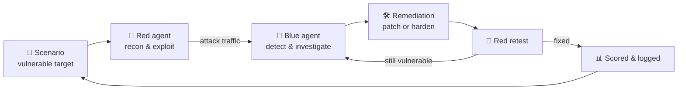
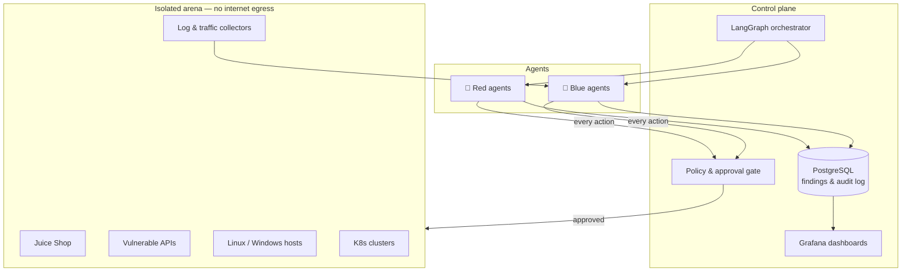

<div align="center">

# ⬛ NULLSITE

### Containment site for hostile AI.

*An open-source cyber range where autonomous Red Team and Blue Team AI agents
attack, detect, and remediate vulnerabilities inside isolated sandboxes.*


[Concept](#-concept) •
[How it works](#-how-it-works) •
[Architecture](#-architecture) •
[Quick start](#-quick-start) •
[Roadmap](#-roadmap) •
[Safety](#-safety-model) •
[Contributing](#-contributing)

</div>

---

> [!WARNING]
> Nullsite runs offensive security agents. Use it **only** against systems you own
> or are explicitly authorized to test. Every target runs inside an isolated
> sandbox by design — never point it at the open internet.

---

## 🧪 Concept

Most security tools run **once** and hand you a report.
Nullsite runs a **contest** — and keeps running it.

Inside a sealed environment, two groups of AI agents face each other:

| | 🔴 **Red Team** — Offense | 🔵 **Blue Team** — Defense |
|---|---|---|
| **Goal** | Find and prove weaknesses | Detect, contain, and fix them |
| **Does** | Recon, vulnerability discovery, controlled exploitation, reporting | Log analysis, attack detection, root-cause investigation, patching, hardening |
| **Wins when** | It reaches an objective inside the rules of engagement | The same attack no longer works |

Every fix gets **retested**. Every attack gets **recorded**. Over time the arena
produces something no single scan can: a measurable history of how a system,
and the agents defending it, got stronger.

---

## 🔁 How it works



1. **Deploy** — a scenario spins up an intentionally vulnerable target in an isolated network.
2. **Attack** — Red agents map the target and attempt exploitation within a defined scope.
3. **Defend** — Blue agents watch logs and traffic, spot the attack, and trace the cause.
4. **Fix** — Blue proposes (or, if allowed, applies) a patch or configuration change.
5. **Retest** — Red attacks again. The vulnerability is only "closed" when the retest fails.
6. **Measure** — every action, finding, and outcome lands in the database and on dashboards.

---

## 🏗️ Architecture



**Key design rules**

- **Every agent action passes the policy gate.** Scope, rate limits, and allowed
  techniques are enforced in code, not in prompts.
- **Disruptive actions need human approval.** Destructive commands, patches to
  running services, and anything outside scope wait for a person.
- **The arena has no route out.** Targets live on internal networks with egress blocked.
- **Everything is logged.** Each prompt, tool call, and result is written to an
  append-only audit trail.

---

## 🧰 Tech stack

| Layer | Tools |
|---|---|
| Core | Python |
| Agent reasoning | OpenAI & Anthropic models |
| Orchestration | LangGraph |
| Sandboxing | Docker, Kubernetes |
| Provisioning | Terraform, Ansible |
| Storage | PostgreSQL |
| Observability | Grafana |
| Targets | OWASP Juice Shop and other intentionally vulnerable apps |

---

## 🚀 Quick start

> [!NOTE]
> Nullsite is in early development. The commands below describe the
> intended phase 1 workflow and will change as the code lands.

```bash
# 1. Clone
git clone https://github.com/<your-username>/nullsite.git
cd nullsite

# 2. Configure your model keys
cp .env.example .env
# edit .env → OPENAI_API_KEY / ANTHROPIC_API_KEY

# 3. Start the isolated arena (Juice Shop + collectors + database)
docker compose up -d

# 4. Run a first match
python -m nullsite run --scenario juice-shop-basic
```

---

## 📁 Project structure (planned)

```
nullsite/
├── agents/
│   ├── red/            # recon, exploitation, reporting agents
│   └── blue/           # detection, investigation, remediation agents
├── orchestrator/       # LangGraph graphs and match flow
├── policy/             # rules of engagement, approval gate
├── scenarios/          # target definitions (compose / k8s manifests)
├── infra/
│   ├── terraform/
│   └── ansible/
├── storage/            # PostgreSQL schema & migrations
├── dashboards/         # Grafana dashboards
└── docs/
```

---

## 🗺️ Roadmap

- [ ] **Phase 1 — Single arena.** Juice Shop in Docker, one Red agent, one Blue agent, full audit log.
- [ ] **Phase 2 — The loop.** Automatic retest after every fix; findings stored and scored.
- [ ] **Phase 3 — Visibility.** Grafana dashboards: time to detect, time to fix, attack success rate.
- [ ] **Phase 4 — More targets.** REST & GraphQL APIs, Linux/Windows hosts, auth systems.
- [ ] **Phase 5 — Infrastructure.** Kubernetes clusters and network devices via Terraform & Ansible.
- [ ] **Phase 6 — Multi-agent.** Several agents per team, collaboration, and head-to-head benchmarks.

---

## 🛡️ Safety model

Nullsite exists to make systems safer. The guardrails are part of the product:

- 🔒 **Isolation first** — targets run on sealed networks with no internet egress.
- 📜 **Rules of engagement as code** — each scenario declares what is in scope.
- ✋ **Human approval** for anything disruptive or out of scope.
- 🧾 **Full audit trail** of every agent decision and action.
- 🚫 **No real-world targets.** Pull requests that add targeting of third-party
  systems will be rejected.

---

## 🤝 Contributing

Ideas, scenarios, and agents are welcome.

1. Fork the repo and create a branch: `git checkout -b feature/my-idea`
2. Keep every new capability behind the policy gate.
3. Open a pull request describing what it does and how it stays contained.

Found a security issue in Nullsite itself? Please open a private security
advisory instead of a public issue.

---

## 📄 License

Released under the [Apache License 2.0](LICENSE).

<div align="center">

**NULLSITE** — *every fix gets tested.*

</div>
